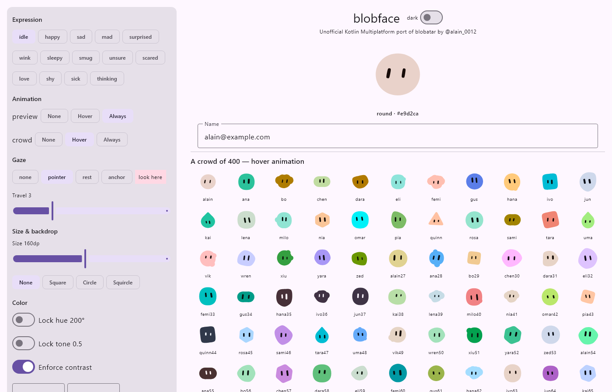
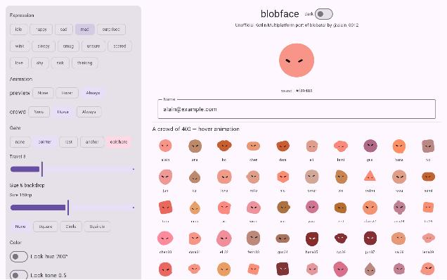
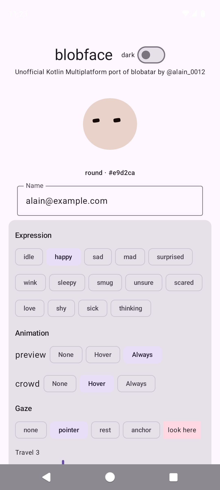

# blobface

Deterministic geometric avatars from any string, for Kotlin Multiplatform and
Compose Multiplatform.

blobface is an unofficial Kotlin Multiplatform port of
[blobatar](https://github.com/Alain00/blobatar) by
[@alain_0012](https://x.com/alain_0012). Not affiliated with or endorsed by the
original author.

**Compatibility:** Same input → same face as blobatar v2.7.0 (commit
[`ebb7ea48`](https://github.com/Alain00/blobatar/commit/ebb7ea4808b1263629fc8fa65e2398b9cbdb6f6b)).
`toSvgString()` is byte-identical to `blobatar(name, opts)`, and this is checked
against fixtures generated from the published npm package (see
[Compatibility](#compatibility)).

**[▶ Try it live](https://pradyumna-dp.github.io/blobface/)**: type any name and
change every option in your browser. This is the sample app built with
Kotlin/Wasm, and it needs a recent Chrome, Edge, Firefox or Safari.



## Install

```kotlin
// build.gradle.kts (a Kotlin Multiplatform module)
kotlin {
    sourceSets {
        commonMain.dependencies {
            implementation("io.github.pradyumna-dp:blobface-compose:0.1.0") // Compose UI (includes core)
            // or, without Compose:
            implementation("io.github.pradyumna-dp:blobface-core:0.1.0")
        }
    }
}
```

With a version catalog:

```toml
# gradle/libs.versions.toml
[versions]
blobface = "0.1.0"

[libraries]
blobface-core = { module = "io.github.pradyumna-dp:blobface-core", version.ref = "blobface" }
blobface-compose = { module = "io.github.pradyumna-dp:blobface-compose", version.ref = "blobface" }
```

```kotlin
commonMain.dependencies {
    implementation(libs.blobface.compose)
}
```

## Usage

### Compose

```kotlin
import io.github.pradyumnadp.blobface.compose.Blobface

@Composable
fun Avatar(email: String) {
    Blobface(email)                       // 48.dp, transparent, static
}
```

```kotlin
Blobface(
    name = user.email,
    size = 96.dp,
    background = BlobfaceBackground.Squircle,
    expression = BlobfaceExpression.Happy,
    animate = BlobfaceAnimation.Hover,     // hover with a mouse, press on touch
    title = "${user.name}'s avatar",       // content description
)
```

The face is drawn natively with Compose `Canvas`/`Path`. There's no SVG
rendering and no WebView.

#### Eyes that follow the pointer

```kotlin
BlobfacePointerArea {                      // optional: share the pointer window-wide
    val gaze = rememberBlobfaceGaze(target = GazeTarget.Pointer, travel = 3f)
    Blobface(user.email, size = 200.dp, animate = BlobfaceAnimation.Always, gaze = gaze)
}

// Other targets:
gaze.lookAt(GazeTarget.Point(Offset(x, y)))   // a point in window px
gaze.lookAt(GazeTarget.Anchor(anchor))        // an element: Modifier.gazeAnchor(anchor)
gaze.lookAt(GazeTarget.Rest)                  // hold still, deliberately not looking
gaze.lookAt(GazeTarget.None)                  // let go; the idle glance comes back
```

### Core (no Compose)

```kotlin
import io.github.pradyumnadp.blobface.Blobface
import io.github.pradyumnadp.blobface.BlobfaceOptions

val svg: String = Blobface.svg("alain@example.com")           // <svg …viewBox="0 0 100 100">…</svg>
val uri: String = Blobface.dataUri("alain@example.com")       // data:image/svg+xml,…

val face = Blobface("alain@example.com", BlobfaceOptions(size = 64, hue = 200.0))
face.shape         // BlobfaceShape.Organic
face.palette       // BlobfacePalette(bg=#…, head=#…, eye=#…)
face.layout        // body, face region, petals, eyes as numbers
face.marks         // drawing primitives (path commands + fills) for your own renderer
face.toSvgString()
```

## Platforms

| Platform | `blobface-core` | `blobface-compose` | Sample |
|---|---|---|---|
| Android | ✅ | ✅ | ✅ `:sample-android` |
| JVM / Desktop | ✅ | ✅ | ✅ `:sample:run` |
| iOS arm64, simulator arm64 | ✅ | ✅ | ✅ `iosApp/` (Xcode) |
| iOS x64 (Intel simulator) | ✅ | — ¹ | — |
| JS (IR, browser + Node) | ✅ | ✅ | ✅ `:sample:jsBrowserDevelopmentRun` |
| Wasm (wasmJs) | ✅ | ✅ | ✅ `:sample:wasmJsBrowserDevelopmentRun` |

¹ Compose Multiplatform 1.12 no longer publishes `iosX64` artifacts.

## Options

Every option of upstream `blobatar(name, opts)` is supported, under the same
names. In Compose they're parameters of `Blobface(...)`. In core they're fields
of `BlobfaceOptions`.

| Option | Default | Notes |
|---|---|---|
| `size` | Compose: `48.dp`; core: none | Compose sets the size. Core emits `width`/`height` when set (an `Int`) |
| `background` | `None` | `Squircle`, `Circle`, `Square`, or `None`. Upstream's `true` = `Squircle` |
| `hue` | from name | Locks the hue in degrees. The name then drives only the shape |
| `tone` | from name | Locks the swatch as a 0–1 position, pale to ink. `1.0` renders like `0.0`; use `0.999` for ink |
| `traits` | — | Pins traits as 0–1 positions: `mapOf("shape" to TraitOverride.of(0.95))`, or a list to choose from: `TraitOverride.anyOf(0.11, 0.825)` |
| `palette` | — | Per-key hex overrides (`bg`, `head`, `eye`). Bypasses the contrast guarantee |
| `normalize` | `true` | NFC + trim + lowercase before hashing |
| `contrast` | `true` | Enforces body/backdrop ≥ 1.25:1 and eyes/body ≥ 4.5:1 |
| `title` | — | `<title>` in SVG, content description in Compose |
| `expression` | idle | `Happy`, `Sad`, `Mad`, `Surprised`, `Wink`, `Sleepy`, `Smug`, `Unsure`, `Scared`, `Love`, `Shy`, `Sick`, `Thinking` |
| `animate` (Compose) | `None` | `Hover` or `Always`. Breathe, bob, blink, glance and a lift. Expression changes morph |
| `gaze` (Compose) | — | Pointer, point, element, rest or none targets |

Trait keys (`BlobfaceTraitKeys.ALL`): `shape, hue, tone, body.r, body.ratio, body.x,
body.y, body.n, body.rot, body.pts, body.r0–7, gaze.x, gaze.y, eye.rx, eye.ratio,
eye.scale, eye.stretch, eye.gap, eye.n, eye.lean, eye.lean2, eye.dy, sun.*, cloud.*,
nub.*, poly.round, capsule.squat, droplet.tip`.

### Animation notes

- **Hover** animates while a mouse hovers over the face, or while a finger is
  pressed on it. Upstream turns hover motion off entirely on touch devices; blobface
  uses press instead, so phones get motion too.
- **Reduced motion** is respected: Android's animator duration scale 0, iOS
  Reduce Motion, and the web's `prefers-reduced-motion`. The face then renders
  still.
- The idle loops, the hover lift and the expression morph use upstream's
  timings and curves: 2.8 s breathe, 3.4 s bob, a seeded blink and glance, and a
  300 ms / 400 ms morph.

## Sample app

The sample shows a text field with a live face, controls for every option, and a
scrolling crowd of 400 names.

```bash
./gradlew :sample:run                              # Desktop
./gradlew :sample-android:installDebug             # Android
./gradlew :sample:wasmJsBrowserDevelopmentRun      # Web (Wasm)
```

For iOS, open `iosApp/iosApp.xcodeproj` in Xcode and run. The build phase calls
`:sample:embedAndSignAppleFrameworkForXcode`.

| Desktop | Web (Wasm) | Android |
|---|---|---|
|  |  |  |

## Compatibility

`tools/generate-fixtures.mjs` uses the npm package pinned to **blobatar 2.7.0**
to write about 6.8 MB of fixtures into
`blobface-core/src/commonTest/resources/fixtures`:

- 500 names: ASCII, mixed case, whitespace, unicode (NFC/NFD, Greek final
  sigma, Turkish İ, CJK, RTL), emoji and ZWJ sequences, lone surrogates, the
  empty string, and very long strings.
- 64 option variants × 16 names: every background, hue, tone, contrast, normalize
  and title value, palette overrides, trait overrides (fixed, lists, empty, NaN,
  out of range), and all 14 expressions.
- Idle-motion frames, pose transforms, pose lerps, colour utilities and gaze
  math.
- About 30,000 `Math.*` results (`sin`, `cos`, `asin`, `atan2`, `exp`, `cbrt`,
  `pow`) recorded from the same engine.

`ParityTest` checks SVG output, data URIs, layout numbers, palettes, marks,
animated SVG parts, motion and gaze math. SVG strings must match **byte for
byte** and numbers **exactly** (`==`). The one tolerance is that `-0` and `0`
compare equal, because JSON can't represent `-0`.

```bash
./gradlew :blobface-core:jvmTest
cd tools && npm ci && node generate-fixtures.mjs   # regenerate (deliberately)
```

To match upstream on every platform, the port reproduces JavaScript behaviour
explicitly: `Math.imul` and `>>>`, `TextEncoder`'s handling of lone surrogates,
JS `trim` whitespace, `Math.round` rounding halves up, JS number formatting,
V8's `Math.hypot`, and a pure-Kotlin port of V8's fdlibm math, used on every
platform. Platform math libraries (Apple's, and the libm in newer JS engines)
differ in the last bit for some inputs. Using one port everywhere makes every
target produce identical output.

### Known differences from upstream

- **`size` is an `Int`** in `BlobfaceOptions`. Upstream accepts any number.
- **Gaze face measurement**: upstream measures the face from the DOM
  (`getBBox`, `isPointInFill`). blobface computes the same measurement from the
  layout geometry, so eye excursions can differ slightly. The gaze *math*
  (projection, pursuit, thresholds) matches exactly.
- **Touch**: press-to-animate, and the pointer gaze follows a finger while it is
  down. Upstream disables both on touch-only devices.
- **NFC and lowercase** use each platform's Unicode tables, just as upstream
  depends on the JS engine's.
- **Engine-dependent math**: blobface pins its math to Node 22 (V8 12.4), which
  produced the fixtures. Newer engines (Node 26, recent Chrome) round `Math.pow`
  differently in the last bit for some inputs, so upstream itself can vary across
  browsers in rare cases. Rounding to 2 decimals hides this in practice.

## Credits

blobface is a port of [blobatar](https://github.com/Alain00/blobatar) by Alain
([@alain_0012](https://x.com/alain_0012)), licensed under MIT. All credit for the
design, the shapes, the colour system, the expressions and the motion goes to the
original author. blobface is an unofficial port and is not affiliated with or
endorsed by them. See [LICENSE](LICENSE) and [NOTICE](NOTICE).
